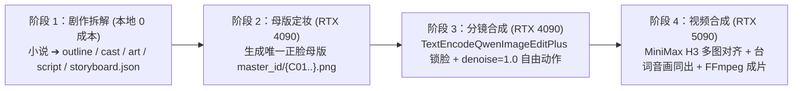

# AI 短剧全自动工业化精简执行计划 (v4.0 通用版)

> **适用题材**：100% 通用（都市、古装、仙侠、末世、科幻、悬疑，支持【写实真剧】与【2D 动漫剧】双风格切换）  
> **技术底座**：`Qwen-Image 2.1` + `Qwen-Image-Edit`（4090 分镜锁脸生图） + `MiniMax H3`（5090 多镜音画同出视频）

---

## 一、 四阶段标准生产流水线 (SOP)



### 阶段 1：结构化剧本与分镜拆解（本地运行）
- **输入**：任意小说章节或故事梗概。
- **工具**：调用 `.agents/skills` 工具链与 `02_通用Prompt标准库.md` 中的阶段一/二 Prompt。
- **产出与校验**：生成 `cast.json`（角色表）、`art.json`（场景与道具表）、`script.json`（节拍剧本）、`storyboard.json`（分镜表），强制通过 **18 道确定性代码校验门**（台词秒数匹配、切点时间对齐、运镜词合规）。

### 阶段 2：唯一官方母版定妆（RTX 4090 节点）
- **单根锚点铁律**：每个核心角色仅生成 **1 张正脸高清母版图**，存入 `characters/master_id/{角色ID}.png`（如 `C01.png`）。
- **杜绝多图漂移**：全剧所有分镜统一只挂这张母版图，严禁链式参考（拿镜头 A 产物去生镜头 B）。

### 阶段 3：三分类解耦分镜批量渲染（RTX 4090 节点）
- **执行引擎**：运行 `03_universal_drama_engine.py`。
- **三分类强制隔离**：
  1. **角色动作镜头 (`character`)**：挂载 `master_id/{角色ID}.png` 注入 `TextEncodeQwenImageEditPlus`，潜空间采用 `EmptySD3LatentImage`（`denoise = 1.0` 满去噪），实现**五官骨相 100% 锁定 + 肢体动作/运镜 100% 自由**。
  2. **纯道具特写镜头 (`prop`)**：不挂任何角色图，使用 `CLIPTextEncode` 纯文生图，强制声明“无人物面孔、无手部肢体”。
  3. **纯场景空镜镜头 (`scene`)**：不挂任何角色图，使用 `CLIPTextEncode` 纯文生图，强制声明“空镜头、无人物肖像”。

### 阶段 4：多切点音画同出视频合成（RTX 5090 节点）
- **输入**：每段（12~15 秒）对应的 3~4 张关键帧（`f1.png` 钉 `0.00s`，`f2.png`、`f3.png` 钉各自切点时刻）及 `h3Prompt`。
- **执行**：提交 `MiniMax H3`（开启 `SageAttention 2` + `TeaCache` 加速），一次性产出带 `<d>[Chinese] …</d>` 角色台词、环境音效与切镜运镜的多镜视频段，最后经 `FFmpeg` 拼接成集。

---

## 二、 通用项目目录结构规范 (任何新剧统一模板)

新建任何一部短剧时，统一在工作区按以下结构建目录：

```text
<任意短剧项目根目录>/
├── outline/
│   └── outline.json              # 分集大纲与爽点节奏表
├── characters/
│   ├── cast.json                 # 角色设定表（含 id, name, persona, promptLocal）
│   └── master_id/                # 【核心】全剧唯一角色正脸母版（每人仅 1 张）
│       ├── C01.png               # 一号角色母版
│       └── C02.png               # 二号角色母版
├── art/
│   └── art.json                  # 场景空镜与关键道具设定表
├── script/
│   └── script.json               # 结构化场次与台词节拍流
└── storyboard/
    ├── storyboard.json           # 通过 18 道门禁校验的故事板数据
    └── renders_qwen_ep01/        # 分镜引擎自动输出目录（含 E01-XX_YY.png 与 gallery.html）
```

---

## 三、 硬件部署与黄金参数表

### 1. RTX 4090 分镜生图黄金参数（ComfyUI）

| 参数项 | 标准设定值 | 作用说明 |
| :--- | :--- | :--- |
| **UNet 主模型** | `qwen_image_2.1_int8_convrot.safetensors` | INT8 量化版，显存占用 ~9GB，画质无损 |
| **CLIP 视觉语言** | `qwen3vl_8b_int8_convrot.safetensors` | 原生读取母版图五官特征与中文镜头指令 |
| **VAE 编解码器** | `qwen_image_2.1_vae_bf16.safetensors` | 原生 BF16 编解码，色彩自然不过饱和 |
| **采样参数** | `euler` + `simple` \| `steps: 20` \| `cfg: 2.5` | `ModelSamplingAuraFlow (shift: 3.1)`，单张 15~25 秒 |
| **去噪幅度** | **`denoise: 1.0`（满去噪）** | 依靠视觉条件锁脸，潜空间从零扩散，彻底消灭“千图一姿” |
| **标准分辨率** | `1056 × 1584`（竖屏 2:3） / `1584 × 1056`（横屏 3:2） | 约 167 万像素原生甜点分辨率 |

### 2. 五道自动化质量熔断门禁（Quality Gates）

1. **门禁 1（剧本/分镜校验门）**：运行 `.agents/skills/novel-storyboard/scripts/novel-storyboard.mjs validate`，18 项指标必须 `failed: 0`。
2. **门禁 2（前置三分类试跑熔断门）**：每部新剧开跑前，先抽取【角色】、【道具】、【场景】各 1 镜试跑，视觉契合度 $\ge 85\%$ 方可放行全量队列。
3. **门禁 3（人脸身份一致性门）**：所有带人物的镜头必须挂载 `master_id/{角色ID}.png`，严禁无参考裸跑主角镜头。
4. **门禁 4（动态种子防雷同门）**：严禁全集共用固定 Seed，强制按 `seed = base_seed + cut_index * 137` 动态递增。
5. **门禁 5（视频切点与音轨门）**：H3 视频落地后校验切点帧直方图跳变与 `<d>` 台词时段音频分贝非空。

---

## 四、 云端运行与两台电脑同步进度操作指引

针对**“两台电脑都不跑本地显卡，全部运行在云端并跨电脑同步进度”**的标准作业流：

1. **接入 Antigravity 云端工作区 (`Remote Workspace`)**：
   - 将本仓库推送至您的 GitHub 私有仓库；
   - 在任意电脑打开 [antigravity.google.com](https://antigravity.google.com) 或桌面端左侧 **Projects** $\rightarrow$ 选择 **Remote Workspace** 关联该仓库；
   - 两台电脑登录同一账号，即可在云端容器中实时共享同一对话与全部文件，本地电脑关机也不中断任务。
2. **跨电脑云端算力断点接力（内置 `progress.json`）**：
   - **电脑 A 提交云端任务**：运行下方命令连接云端 AutoDL/算家云 ComfyUI，脚本会将每个分镜的云端 `prompt_id` 实时写入 `renders_qwen_epXX/progress.json`；
   - **电脑 B 无缝接管**：电脑 B 同步代码后执行同一命令，引擎会自动跳过已完成镜头，并根据 `progress.json` 中的 `prompt_id` 直接从云端 `/history` 回收电脑 A 投递后在云端算完的图片。

### 一键云端生产命令 (CLI)

```powershell
# 1. 写实国剧风（默认）连接云端 GPU 渲染任意短剧第 1 集（支持双机断点续跑）：
python "E:\codex\video\AI短剧通用工业化核心包\03_universal_drama_engine.py" --project "E:\codex\video\<短剧目录名>" --comfy-url "http://<云端算力地址:端口>" --ep 1 --style realistic

# 2. 精品 2D 漫剧风连接云端 GPU 渲染任意短剧第 1 集：
python "E:\codex\video\AI短剧通用工业化核心包\03_universal_drama_engine.py" --project "E:\codex\video\<短剧目录名>" --comfy-url "http://<云端算力地址:端口>" --ep 1 --style anime
```
